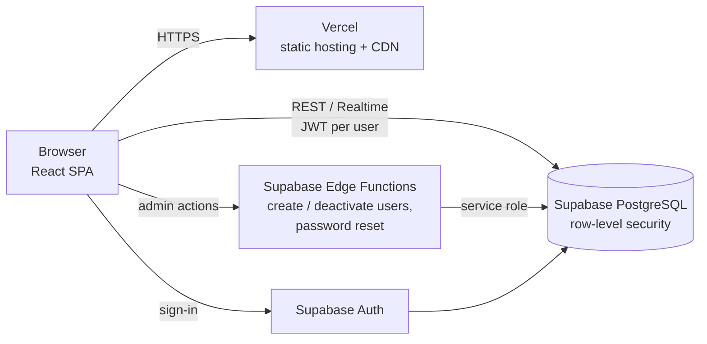
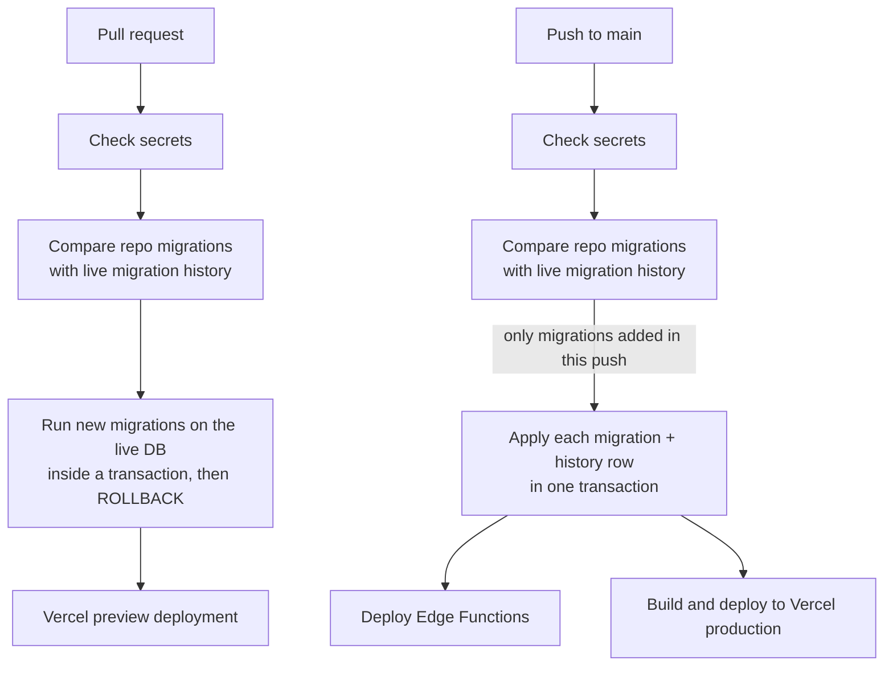

# NeoSAIMS – Sales and Inventory Management SaaS

A multi-tenant web application that lets small businesses run inventory, sales, purchasing,
invoicing and payments in one place. I took it from a low-code prototype to a production
service with an automated, database-aware deployment pipeline.

**Live:** https://neon-sales-and-inventory-management.vercel.app
**Demo login:** _coming soon_

> The source code is private because it runs a live business. This repository shows the
> architecture, the delivery pipeline and selected excerpts. I'm happy to walk through the full
> codebase in an interview.

---

## At a glance

| | |
|---|---|
| **Role** | Owner and sole engineer (architecture, development, DevOps) |
| **Stack** | React 18, TypeScript, Vite, Tailwind CSS · Supabase (PostgreSQL, Auth, Edge Functions) · GitHub Actions · Vercel |
| **Scale of work** | 69 versioned database migrations · 4 serverless functions · 20+ application screens |
| **Outcome** | Live in production. Database changes are tested on every pull request and deployed with the site on every push to `main` |

## What the application does

- **Inventory:** items, categories, low-stock alerts, CSV import, inventory valuation and analysis
- **Sales and purchasing:** sales orders, purchase orders and suppliers, with stock adjusted automatically
- **Invoicing:** invoices, partial payments, payment history, PDF invoices and printable receipts
- **Analytics:** income and revenue dashboards, profit, customer and supplier performance over any date range
- **Accounts:** self-service company sign-up with email verification, users with custom roles and
  95 fine-grained permissions, deactivation instead of deletion, per-company currency and pricing rules
- **Platform monitoring:** a cross-company dashboard for the service operator

## Architecture

**Tenant isolation is enforced in the database, not the UI.** Every business table carries a
`tenant_id`, and PostgreSQL row-level security policies limit each signed-in user to their own
company's rows. Privileged operations, such as creating users, assigning roles and deactivating
accounts, run in server-side functions that re-check the caller's company and role.

## Delivery pipeline

Key design decisions (full workflow: [`excerpts/deploy.yml`](excerpts/deploy.yml)):

- **Pull requests prove migrations against real data without changing it.** New SQL files are
  run on the live database inside a transaction that is always rolled back, so a bad migration
  fails the PR instead of failing production.
- **The pipeline refuses to guess.** If the live database's migration history disagrees with the
  repository about anything other than this push's new files, the job stops and changes nothing.
- **Each migration and its history record commit together**, so a failure can never leave the
  database half-migrated or out of step with its history.
- **Edge cases handled explicitly:** `ALTER TYPE … ADD VALUE` can't be used in the same
  transaction that adds it, so enum migrations are trial-run on their own.
- **Pinned tooling:** the Vercel CLI version is pinned after an upstream release broke every deploy.

## Problems I solved

| Problem | What I did |
|---|---|
| **Users of one company could change another company's roles** through a database function that checked permissions but not company | Added a same-company check to every role and permission path, and stopped non-admins from changing their own role ([`excerpts/tenant-isolation.sql`](excerpts/tenant-isolation.sql)) |
| **Migration history out of sync:** the prototype tool had recorded migration versions that didn't match the files | Reconciled 47 migrations against the live history (with a backup of the old table) so the pipeline could run safely |
| **Supabase CLI misparsed a valid connection string** in CI | Replaced it with plain `psql` and explicit transactions, using the same connection logic for checking and applying |
| **Profit always showed 0** in production | Traced it to duplicate foreign keys making an API join ambiguous; dropped the duplicates in a migration and made errors visible on the page instead of failing silently |
| **Users created by an admin landed in a brand-new company** because auth metadata is stored after the user insert trigger runs | Moved the users into the right company in a server-side function, and only removed the stray company when it was empty |
| **Slow start-up** | Fixed an effect loop that refetched data on every render, and split routes so the initial bundle went from **657 KB to 148 KB** (gzipped) |
| **Payment totals didn't match payment records** | Back-filled the missing payment records with a reviewed, one-time migration |

## Also explored: a Google Cloud backend

I built and tested a full alternative backend before deciding to stay on Supabase:

- A Node.js API (Hono) for Cloud Run, using PostgreSQL on Cloud SQL and Firebase Authentication
- Stock changes made in one place, locking rows in a fixed order and failing the whole
  transaction when stock is insufficient
- Integration tests against a real PostgreSQL database in Docker
- Scripts that convert a Supabase schema dump for Cloud SQL and import existing user accounts

## Screenshots

_Coming soon (taken from a demo company with sample data)._

<!--

-->

---

**Ebenezer Olaleye** · DevOps Engineer · [LinkedIn](https://linkedin.com/in/ebenezerolaleye)
